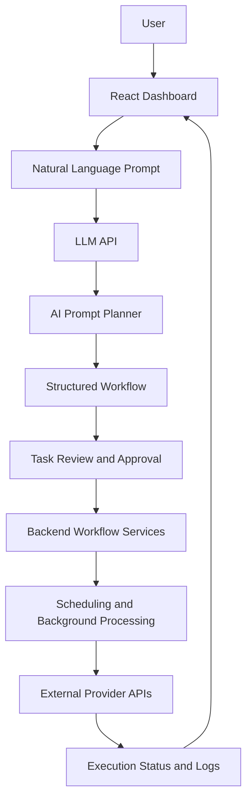

# OmniAI — AI-Powered Workflow Automation Platform

\<p align="center">   \<strong>Turn natural-language instructions into intelligent, automated workflows.\</strong> \</p>

OmniAI is a full-stack AI-powered content creation and workflow automation platform that transforms natural-language prompts into structured, AI-planned tasks. It brings content generation, social media publishing, business messaging, email automation, scheduling, approvals and workflow tracking together in one unified dashboard.

The platform integrates Large Language Model (LLM) APIs with backend workflow services to simplify repetitive digital tasks and help users manage multiple automation workflows from a single application.

---

## 🚀 Project Overview

Managing content creation, social media accounts, business communication and recurring tasks across different platforms can be time-consuming.

OmniAI aims to simplify these activities through an AI-driven workflow system.

Users can describe a task in natural language. The AI prompt planner processes the instruction and helps organize it into a structured workflow that can be reviewed and executed through the application.

The platform combines AI-powered planning with API-based integrations, background processing and workflow management.

## ✨ Key Features

### 1. AI-Powered Workflow Planning

- Accepts natural-language instructions through an interactive prompt composer.
- Uses an OpenAI-compatible LLM API for AI-powered prompt planning.
- Organizes user instructions into structured workflow tasks.
- Supports AI-assisted content and copy generation.

### 2. AI Content Creation

- AI-assisted social media copy generation.
- Video generation through a Replicate-compatible API adapter.
- Media asset management and storage records.
- Content preparation for supported publishing platforms.

### 3. Social Media Automation

Provider adapters and OAuth integration routes are included for:

- **Facebook:** Page-based content publishing.
- **Instagram:** Publishing support for eligible professional accounts.
- **LinkedIn:** Text, image and video publishing.
- **YouTube:** Video uploads and channel statistics.

### 4. Business Messaging

- WhatsApp Cloud API text and template messaging.
- Telegram Bot API messaging.
- SMTP-based email delivery.
- Webhook-based WhatsApp delivery status processing.

### 5. Workflow Scheduling and Automation

- One-time scheduled tasks.
- Recurring workflows using cron scheduling.
- Timezone-aware scheduling.
- Background workflow execution.
- Approval gates before selected actions.
- Execution logs and retry-friendly task states.

### 6. Dashboard and Analytics

- Interactive dashboard.
- Task review and workflow management.
- Media library.
- Connected account management.
- Analytics and activity tracking.
- Application settings and recurring automation interface.

### 7. Authentication and Subscription Management

- User authentication.
- Encrypted provider token storage.
- OAuth account connection and disconnection.
- Token refresh support where supported by providers.
- Stripe Checkout and customer portal integration.
- Subscription lifecycle webhook processing.

---

## 🧠 AI Workflow Architecture

OmniAI connects natural-language input with AI planning and backend workflow services.

### High-Level Workflow



### Architecture Components

| Component         | Responsibility                                      |
| ----------------- | --------------------------------------------------- |
| React Frontend    | Dashboard, prompt composer and workflow interface   |
| Express Backend   | REST APIs and application services                  |
| LLM Integration   | AI prompt planning and content generation           |
| MongoDB           | Application data and workflow records               |
| Redis             | Background processing and supporting infrastructure |
| Scheduler         | One-time and recurring workflow scheduling          |
| Provider Adapters | Communication with external services                |
| Webhook Handlers  | Processing external events and delivery updates     |

---

## 🛠️ Technology Stack

### Frontend

- React.js
- Vite
- JavaScript
- React Router
- Lucide React

### Backend

- Node.js
- Express.js
- REST APIs

### AI Integration

- OpenAI-compatible LLM APIs
- Prompt Engineering
- Natural-Language-Based Workflow Planning
- AI Content Generation

### Database and Infrastructure

- MongoDB
- Redis
- Docker Compose

### External Integrations

- Meta Graph API
- LinkedIn API
- YouTube Data API
- WhatsApp Cloud API
- Telegram Bot API
- SMTP
- Stripe
- Replicate-compatible video generation API

---

## 📁 Project Structure

```text
omniai-platform/
│
├── client/
│   └── React frontend application
│
├── server/
│   └── Express backend application
│
├── docs/
│   ├── SETUP.md
│   ├── INTEGRATIONS.md
│   ├── ARCHITECTURE.md
│   └── VERIFICATION.md
│
├── .env.example
├── .gitignore
├── docker-compose.yml
├── package.json
├── package-lock.json
└── README.md
```

---

## ⚙️ Installation and Setup

### Prerequisites

Make sure the following are installed:

- Node.js 20 or later
- npm
- Docker Desktop
- Git

### 1. Clone the Repository

```bash
git clone https://github.com/rajeshwaridatti3-coder/omniai-platform.git

cd omniai-platform
```

### 2. Configure Environment Variables

Copy the example environment file:

```bash
cp .env.example .env
```

On Windows PowerShell:

```powershell
Copy-Item .env.example .env
```

Configure the required environment variables, including:

- JWT secret
- Encryption key
- MongoDB connection
- Redis connection
- LLM provider credentials
- External integration credentials, when required

Generate secure secrets for your local environment. Never commit your actual `.env` file or API credentials to GitHub.

### 3. Start Infrastructure

```bash
docker compose up -d
```

This starts the configured MongoDB and Redis services.

### 4. Install Dependencies

```bash
npm install
```

### 5. Start the Application

```bash
npm run dev
```

### 6. Open the Application

Visit:

```text
http://localhost:5173
```

Register an account and configure the required provider credentials before testing external integrations.

---

## 🔌 External API Configuration

OmniAI includes integration adapters and routes for multiple external services.

Live provider operations require additional configuration, such as:

- Developer application registration.
- OAuth client credentials.
- Correct redirect URLs.
- Required API permissions and account eligibility.
- Webhook URLs accessible over HTTPS.
- Provider-specific API keys and tokens.

Some integrations may require platform approval or additional permissions before they can be used.

Refer to the integration setup guide:

[`docs/INTEGRATIONS.md`](docs/INTEGRATIONS.md)

---

## 🔐 Security Considerations

Security is an important part of the platform.

- Encrypted storage for provider tokens.
- Signed webhook verification.
- Webhook event deduplication.
- Approval gates for selected workflow actions.
- Execution tracking and retry-friendly task states.
- Environment-based configuration for sensitive credentials.

**Important:** Never upload API keys, access tokens, refresh tokens, signing secrets or customer information to a public repository.

Use test accounts during development and keep approval controls enabled while validating integrations.

---

## 📚 Documentation

For additional technical details, refer to:

| Documentation                              | Description                             |
| ------------------------------------------ | --------------------------------------- |
| [Setup Guide](docs/SETUP.md)               | Local installation and configuration    |
| [Integration Guide](docs/INTEGRATIONS.md)  | External provider setup                 |
| [Architecture](docs/ARCHITECTURE.md)       | Application architecture and components |
| [Verification Notes](docs/VERIFICATION.md) | Implementation and verification status  |

---

## 🧪 Verification and Project Status

The application has been started locally, and the frontend and backend health endpoint have been tested.

The project includes provider adapters and integration routes, but external provider functionality depends on valid credentials, OAuth configuration, permissions and webhook setup.

Not all external integrations should be considered production-verified merely because their adapters are present.

For detailed implementation and verification information, see [`docs/VERIFICATION.md`](docs/VERIFICATION.md).

---

## 🎯 Project Objectives

- Explore practical applications of Large Language Models in workflow automation.
- Convert natural-language instructions into structured tasks.
- Integrate AI-powered planning with backend automation services.
- Build reusable integrations for external platforms.
- Manage scheduled workflows and execution states.
- Develop a unified interface for AI-assisted digital productivity.

---

## 👩‍💻 Author

**Rajeshwari Datti**

Computer Science and Engineering
National Institute of Technology, Patna

GitHub: [@rajeshwaridatti3-coder](https://github.com/rajeshwaridatti3-coder)

---

## 📌 Project

**OmniAI — AI-Powered Workflow Automation Platform**

[View Repository](https://github.com/rajeshwaridatti3-coder/omniai-platform)
